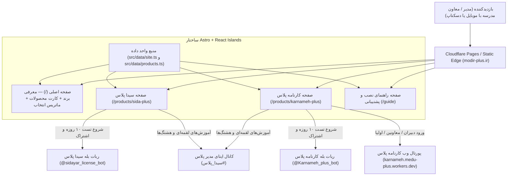

# مدیر پلاس (Modir Plus) — System Architecture & Technical Specification

این سند معماری فنی، ساختار صفحات، جریان داده‌ها و الگوی استقرار وب‌سایت **مدیر پلاس (`modir-plus.ir`)** را مستند می‌کند.

---

## ۱. معماری کلان و توپولوژی استقرار

---

## ۲. اصول معماری فرانت‌اند (Astro + React Islands + Tailwind v4)

1. **رندر استاتیک با حداقل جاوااسکریپت (`Zero-JS by default`):**
   - هدر، فوتر، کارت‌های متنی، بخش سناریوها و ساختار صفحات در زمان بیلد به HTML خالص تبدیل می‌شوند.
   - فقط بخش‌های نیازمند تعامل زنده به‌صورت React Islands بارگذاری می‌شوند:
     - `ThemeToggle.tsx`: سوییچ بین تم روشن و تم تیره بدون FOUC.
     - `BrowserInstallBox.tsx`: تشخیص مرورگر بازدیدکننده (Chrome/Edge/Firefox یا موبایل)، برجسته‌سازی مسیر نصب مناسب و دکمه کپی لینک صفحه برای باز کردن در سیستم مدرسه.
     - `ProductLightboxGallery.tsx`: گالری اسکرین‌شات‌ها + پیش‌نمایش‌های تعاملی UI واقعی با زوم، ناوبری کیبوردی (RTL-aware) و کپشن حاشیه‌نویسی‌شده.
     - `WorkflowScenarioTabs.tsx`: سوئیچ سناریوهای کاری واقعی محصول (مثلاً در سیدا پلاس: عملیات سیدا / برنامه هفتگی / شاد؛ در کارنامه پلاس: کارنامه / پورتال دبیر / انضباط ۶ زنگی).
     - `FaqAccordion.tsx`: آکاردئون دسترس‌پذیر با ARIA استاندارد.

2. **الگوی جایگزینی بدون اصطکاک تصاویر (`Mock UI -> Real Screenshot Swap`):**
   - در فاز اولیه، پیش‌نمایش‌های هر محصول بر پایه المان‌های واقعی نرم‌افزار (تب‌ها، جداول، برچسب‌ها و دکمه‌های واقعی سیدا پلاس و کارنامه پلاس) طراحی می‌شوند.
   - مدل داده هر تصویر در `ProductScreenshot` به‌گونه‌ای است که با قرار دادن تصاویر `WebP/AVIF` نهایی در `public/images/products/` و تنظیم فیلد `imageSrc`، بدون تغییر کامپوننت نمایشی جایگزین می‌شوند.

3. **مسیرهای کلیدی (URL-First Deep Linking):**
   - `/`: صفحه اصلی مدیر پلاس
   - `/products/sida-plus`: صفحه اختصاصی معرفی، گالری، دانلود و آموزش‌های سیدا پلاس
   - `/products/karnameh-plus`: صفحه اختصاصی معرفی، گالری، دانلود، درگاه‌های وب و آموزش‌های کارنامه پلاس
   - `/guide`: راهنمای گام‌به‌گام نصب افزونه روی مرورگرها، سوالات متداول و سیاست حفظ حریم خصوصی مدارس

---

## ۳. مدل داده مرکزی (`src/data/products.ts`)

هر محصول از یک تایپ واحد (`ProductDefinition`) تبعیت می‌کند شامل:
- شناسه (`slug`)، نام فارسی/انگلیسی، نسخه فعلی، شعار ارزش پیشنهادی
- مخاطبان اصلی (مدیر، معاون آموزشی، معاون اجرایی، معاون پرورشی، دبیر)
- لیست مقایسه **قبل و بعد** (`beforeAfterItems`)
- لیست سناریوها بر اساس نقش (`useCases`)
- ماژول‌های کلیدی و اسکرین‌شات‌ها/پیش‌نمایش‌های واقعی (`galleryItems`, `uiMockPreset`)
- کادر نصب چندمرورگره (`installTargets`: Chrome، Edge، Firefox، لینک مستقیم یا بسته کمکی + لینک ویدئوی نصب)
- درگاه‌های وب تکمیلی (`externalPortals` — در کارنامه پلاس برای پورتال اولیا/دبیر/معاون)
- ربات بله اختصاصی (`baleBotHandle` و `baleBotUrl`) و متن شفافیت ۱۰ روز تست رایگان
- لینک کانال مرکزی ایتا + فهرست آموزش‌های لقمه‌ای ۳۰ تا ۶۰ ثانیه‌ای با هشتگ و لینک مستقیم پست (`tutorials`)
- سوالات متداول اختصاصی هر محصول (`faqs`)
